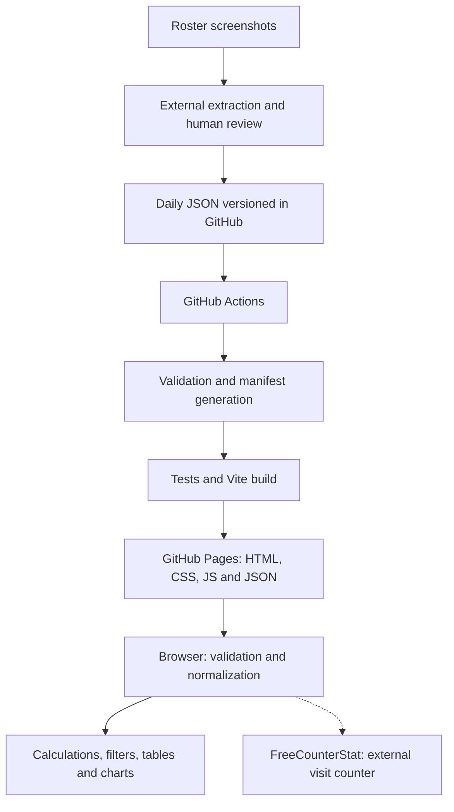

# DESO Alliance Dashboard — Technical documentation

**Project credit: Anderson Tagata — ATTecnologies, 2026.**

Project version: 1.0.0 · Daily schema: 2 · Reference: implementation published in October 2026.

Language: English (EN) · [Português (PT)](TECHNICAL.md) · Documentation revision: 2026-10-22.

The PT and EN versions are maintained together for improvements and fixes, following the [maintenance policy](#15-bilingual-documentation-maintenance).

- Repository: <https://github.com/attagata/deso-dashboard>
- Application: <https://attagata.github.io/deso-dashboard/>
- Installation and operations guide: [README](../README.md)
- Attribution and license: [NOTICE](../NOTICE) and [Apache 2.0](../LICENSE)

## 1. Purpose and scope

A public, read-only dashboard for members of the DESO / Death Soldiers alliance, server 2052, in Last War: Survival. It provides date-based queries, rankings, individual power/HQ/rank history, activity monitoring and rank differences between captures.

The production interface is in English. Player names and source metadata are preserved. A parallel Portuguese version of this documentation supports maintenance by the administrator.

The website does not modify the game, execute administrative decisions or process screenshots. Screenshot extraction and data review take place externally, with ChatGPT and the administrator. There is no application backend, database, authentication, external processing API for alliance data, Docker or paid infrastructure. The approved exception to local-only requests is the FreeCounterStat counter described in section 16.

## 2. Architecture



GitHub Actions is used only to build, verify and publish static files. All calculations displayed on the dashboard run in the browser. The local Vite server is a development tool, not a dependency of the published application.

### Technologies and decisions

| Area | Implementation | Reason |
| --- | --- | --- |
| Interface | React 19 and strict TypeScript | Small components and explicit contracts |
| Build | Vite 7 and TypeScript 5.9 | Static build and type checking |
| Charts | Recharts 3 | Power history and rank distribution |
| Styling | Custom CSS and system fonts | Responsive layout without a visual framework or external fonts |
| State | Local React hooks | Small data volume, without a global state library |
| Data | Daily JSON, schema 2 | Readable, reviewable, versioned history |
| Navigation | URL fragment, `location.hash` | Profiles support direct refreshes on GitHub Pages |
| Tests | `node:test` and `node:assert/strict` | No additional test dependency |
| Tooling runtime | Node.js 24 and npm | Running tests and the TypeScript validator |
| Publication | Official GitHub Pages actions | No additional application infrastructure |
| Counter | Asynchronous FreeCounterStat embed | Approximate counting as an approved external exception |

Exact installed versions are pinned in [package-lock.json](../package-lock.json). Declared version ranges are in [package.json](../package.json).

## 3. Code organization

| File or directory | Responsibility |
| --- | --- |
| `index.html` | Static document, React root and external counter at the bottom of the page |
| `src/main.tsx` | Mounting the application in `StrictMode` and importing CSS |
| `src/App.tsx` | Loading, minimal shared state, hash routing, date selection, navigation and footer credits |
| `src/components/Dashboard.tsx` | Metrics, top 10, rank movements and guidelines |
| `src/components/MemberTable.tsx` | Search, filters, sorting, badges, changes and pagination with 25 records |
| `src/components/MemberDetails.tsx` | Profile, historical observations and membership events |
| `src/components/PowerChart.tsx` | Power time series with explicit gaps |
| `src/components/RankDistribution.tsx` | Rank distribution with a numeric legend |
| `src/components/ActivityMonitor.tsx` | Activity categories and administrative review list |
| `src/components/Icons.tsx` | Local SVG icons |
| `src/services/dataService.ts` | Downloading local JSON files and runtime validation |
| `src/types/member.ts` | Daily schema and normalized data types |
| `src/utils/statistics.ts` | Deterministic normalization, count and difference functions |
| `src/utils/validation.ts` | Shared structure and timeline validation rules |
| `src/styles.css` | Theme, responsiveness, tables and visual accessibility |
| `scripts/validate-data.mjs` | File discovery, validation and manifest generation |
| `tests/statistics.test.ts` | Calculations, missing data, identity, chronology and source preservation |
| `public/data/` | Published data source |
| `source-data/` | Original history preserved for auditing |
| `.github/workflows/deploy.yml` | Verification and deployment pipeline |

## 4. Data contract

### 4.1 Daily files

Each daily capture is a `public/data/YYYY-MM-DD.json` file. The `date` field must match the filename. There is one capture per date; two observations of the same player on the same day are not accepted.

Minimum valid structure, intentionally containing no fictitious players:

```json
{
  "schema_version": 2,
  "date": "2026-10-21",
  "alliance": {
    "tag": "DeSo",
    "name": "Death Soldiers",
    "server": "2052"
  },
  "summary": {},
  "observations": [],
  "membership_events": []
}
```

The date above is illustrative. A valid empty file is not equivalent to a complete capture and should not be published as a substitute for data that has not yet been extracted.

### 4.2 Observations

| Field | Type | Meaning |
| --- | --- | --- |
| `player_id` | Nonempty string | Stable internal identity across files |
| `name` | Nonempty string | Name observed in that capture |
| `rank` | `R1` through `R5`, or `null` | Rank actually observed |
| `base_level` | Positive integer or `null` | HQ level |
| `power_m` | Nonnegative number or `null` | Power in millions, at source precision |
| `visible` | Boolean | Player observed or explicitly unobserved |
| `last_seen` | `online`, a value suffixed with `m`/`h`/`d`, or `null` | Observed indicator preserved as text |
| `last_seen_minutes` | Nonnegative number or `null` | Nominal conversion of the observed interval |
| `online_at_capture` | Boolean or `null` | Online at capture time, separately from elapsed time |
| `source` | Nonempty string | Evidence source |
| `identity_uncertain` | Optional boolean | Prevents rank movement conclusions when true |
| `profile` | Optional object | Additional profile metadata for that date |
| `membership_status` | Optional string | Preserved legacy field; does not govern historical classification |

Observations inherit the file's date. Unknown data uses `null`, never zero as a substitute. Zero power should represent only an actual observation of that value.

When `visible` is false, `rank`, `base_level`, `power_m`, `last_seen`, `last_seen_minutes` and `online_at_capture` must be `null`. Omitting a row also results in unobserved status for a previously known identity.

`online_at_capture: true` requires `last_seen: "online"` and `last_seen_minutes: null`. An interval such as `2h` nominally corresponds to 120 minutes; it does not represent session duration, daily playtime or greater precision than the original capture.

### 4.3 Official summary and events

`summary` may store `reported_members`, `reported_ranks` and `alliance_power` from game headings, along with original metadata. Official power uses full units; each player's `power_m` uses millions. These values are not interchangeable.

`membership_events` accepts `departure` and `rejoin`. Each event requires `player_id`, `name`, `recorded_on`, `effective_date` and `source`; `previous_rank` is optional. The recording date must match the capture. The effective date may be unknown (`null`), but cannot be later than confirmation.

A departure is recorded once and retained in history. An explicit rejoin event is required for an identity with a confirmed departure to appear as active again. The application classifies membership using the confirmation date, avoiding assignment of an effective date that the evidence does not establish.

### 4.4 Automatic manifest

`npm run validate:data` discovers daily files, sorts their names, validates the data and writes `public/data/index.json` only when no errors are found:

```json
{
  "schema_version": 2,
  "last_updated": "2026-10-20",
  "files": [
    "2026-10-14.json",
    "2026-10-19.json",
    "2026-10-20.json"
  ]
}
```

The administrator does not need to edit the manifest daily. GitHub Pages does not provide directory listings for this purpose; the manifest tells the browser which files to load.

## 5. Migration and traceability

The supplied schema 1.1 file was preserved in full in [source-data](../source-data/DESO_member_history_2026-10-14_to_2026-10-20.json). It contains 103 identities and captures from October 14, 19 and 20, 2026.

The migration distributed each `players[].snapshots[date]` into the corresponding daily file, retaining original fields and adding `player_id` and `name` to the row. Dated profiles were attached to their respective observations; alliance metadata, summaries and data policy were preserved. Events appear on the date they were recorded.

Undated global statuses and additional departure descriptions remain in the original audit file. They are not retroactively applied to the roster. The preservation test compares the three initial files with the supplied source; deliberate corrections to those captures require reviewing this comparison, with justification recorded in Git, without silently changing the original.

| Date | Visible | Individual sum | Confirmed departures through date | Known but unobserved |
| --- | ---: | ---: | ---: | ---: |
| 2026-10-14 | 91 | 5,429,600,000 | 0 | 0 |
| 2026-10-19 | 97 | 5,615,800,000 | 4 | 0 |
| 2026-10-20 | 98 | 5,690,200,000 | 4 | 1 |

On October 19, recorded official power is 5,611,412,930. The difference from the individual sum remains explicit, without artificially adjusting player values.

## 6. Loading and normalization

1. `App` starts `loadData` with an `AbortController` and cancels requests on unmount.
2. `dataService` loads the manifest and checks the list of allowed filenames.
3. Daily files are fetched in parallel with `Promise.all`.
4. Each response undergoes JSON parsing, structural validation and comparison of the date with the filename.
5. The complete sequence undergoes chronological validation.
6. `normalizeSnapshots` groups players by ID and associates observations and events in date order.

Requests use `import.meta.env.BASE_URL`, `cache: 'no-store'` and a refresh query parameter based on `Date.now()`. There is no service worker or authoritative local persistence. Reloading the page fetches the data again; the website does not continuously poll while open.

Main mapping:

| Daily source | In-memory model |
| --- | --- |
| `player_id` | `Member.id` |
| File `date` | `Observation.date` |
| `power_m` | `power = Math.round(power_m * 1_000_000)` |
| `base_level` | `level` |
| `last_seen` | `activityText` |
| `last_seen_minutes` | `inactivityMinutes` |
| `online_at_capture` | `online` |
| `identity_uncertain` | `identityUncertain`, false when omitted |

Numeric conversion does not increase capture precision. The application preserves `null` when no value is available.

## 7. Calculation rules

Functions are in [statistics.ts](../src/utils/statistics.ts) and do not depend on the current clock, local storage or external services.

### Membership and selected date

`rowsForDate` considers only records through the selected date. Identities not yet known on that date do not appear in the historical roster. The selected observation must match the date exactly; old values do not fill missing fields.

| Status | Rule |
| --- | --- |
| `departed` | Latest confirmed event through the date is a departure |
| `active` | No ongoing departure status and a visible observation on the date |
| `unobserved` | Known identity, no ongoing departure status and no visible observation on that date |

`lastKnown` holds the latest visible observation through the date for historical context. It does not substitute for that day's power or activity. The profile also presents the latest values across the full history, identified as latest; its chart and table show all available observations.

### Power, position and changes

`summarize` sums non-null values for active players observed on the date and reports record coverage. An unknown value does not become zero in the record, although it does not contribute to the partial sum. The official total is displayed separately.

The ranking uses descending power, ties broken by name in English locale and then by ID. Only active players with known power receive a position. Table sorts and filters do not change alliance totals.

```text
Absolute change = current observed power − power of the previous visible observation
Percentage change = absolute change / previous power × 100
```

If the previous observation or its power is unknown, the change is unknown. The comparison does not skip a null power value to find an older number. Percentages are calculated only when previous power is positive. Changes with a magnitude of at least 10% are visually highlighted, without automatic performance judgments.

### Newly observed players and ranks

“Newly observed” counts active players whose first visible observation is on that date. The indicator is undefined for the initial capture, which serves as the baseline. It does not establish the alliance join date.

The R1–R5 distribution uses only known ranks of active players in the capture. `rankMovements` compares adjacent capture dates: it requires two visible observations, known and different ranks, and a certain identity. A missing capture observation prevents a conclusion about movement between those points. The exact administrative action date remains unknown.

### Activity

| Category | Rule |
| --- | --- |
| Online | Online at capture, regardless of null minutes |
| Recently Active | Less than 1,440 minutes |
| Away | From 1,440 to less than 7,200 minutes |
| Review Required | At least 7,200 minutes, nominally equivalent to five days |
| Unknown | No visible observation or insufficient activity information |

Time is not extrapolated from the capture date. The review list uses active players with sufficient evidence on the selected date. Five days away triggers officer review; it does not automatically cause removal, demotion or expulsion.

## 8. Interface, navigation and charts

Routes are `#/` and `#/member/ID`, with `?date=YYYY-MM-DD` inside the fragment. The ID is encoded in the URL. Because the fragment is not sent to the server, a direct refresh opens the same static document and preserves the profile.

An unavailable date generates an explicit notice and selects the latest capture. An unknown ID displays a player-not-found state. The application also distinguishes loading, empty dataset and data failure states.

The power chart uses measured points and a straight line as a visual guide, with `connectNulls={false}` and null values on dates without an observation. It does not interpolate records. Chart animations are disabled. Chart components are loaded with `React.lazy`/`Suspense`; the build separates Recharts into its own chunk.

The layout uses native controls, horizontal table scrolling and pagination with 25 members. It includes accessible labels, keyboard navigation, visible focus and a history table as a numeric alternative to the chart. Simulated screen-width checks do not replace testing on a physical iPhone.

## 9. Validation and tests

```sh
npm run validate:data
npm test
npm run build
```

`validateDailyData` checks required fields, schema, real dates, ranks, numeric types, negative values, activity, visibility, sources, duplicate identities and events. Duplicate normalized names within a day are flagged for identity review. Name normalization during this check does not change the stored name.

`validateTimeline` checks chronological order, duplicate dates, identities referenced by events, repeated departures, rejoins without a prior departure and observations after departure without an explicit rejoin. The command-line tool also checks JSON syntax and filenames. On failure, it returns a nonzero exit code and does not regenerate the manifest. In the browser, invalid data generates an error message instead of partially accepted statistics.

The 11 original statistics and integrity tests cover the items below; the 15 additional performance analysis tests are described in section 14, for a total of 26:

1. Positive and negative power differences, percentages and unknown values.
2. Counts and rank distributions for real captures.
3. Exact activity category boundaries.
4. Departures by confirmation date and preservation of unobserved players.
5. Missing power and observations without automatic filling.
6. Rank changes with adjacent captures and certain identity.
7. Name changes without losing identity.
8. Duplicate IDs, observations and dates.
9. Invalid fields, ranks, power, units and dates.
10. Inconsistent chronology, rejoins and effective dates.
11. Preservation of original observations, profiles, metadata and events.

The initial release was also checked in Chromium with search, filters, pagination, date selection, profile refresh, charts, empty/error states and widths of 320, 375, 390, 768 and 1440 pixels. These browser checks were executed in the development environment and are not part of the `npm test` script.

## 10. Build and deployment

Reproducible installation: `npm ci`. Development: `npm run dev`. Local build preview: `npm run preview`. The build runs validation, `tsc -b` and `vite build`, producing `dist/`.

The workflow is triggered by pushes to `main` or `master`, pull requests and manual dispatch. Pull requests run verification without publication. For pushes or manual dispatch:

1. Check out the source and configure Node.js 24 with npm caching.
2. Install from the lockfile with `npm ci`.
3. Validate data and generate the manifest.
4. Run tests.
5. Compile the application using the repository name as the base path.
6. Upload `dist/` with `actions/upload-pages-artifact`.
7. Configure and publish with `actions/configure-pages` and `actions/deploy-pages`.

The build job has `contents: read`. The deployment job uses `pages: write` and `id-token: write` for OIDC, without credentials in code. Concurrency cancels earlier runs for the same reference. The original repository uses `master` as its default branch; both branches are supported, but future changes should be synchronized or concentrated on the chosen publication branch to avoid divergent deployments.

Initial activation: **Settings → Pages → Build and deployment → Source → GitHub Actions**. The development integration may be able to push code without administrative access to enable this feature; in that case, the owner configures it once.

`vite.config.ts` defaults to `/deso-dashboard/`. In CI, `VITE_BASE_PATH` receives `/${repository-name}/`. When migrating to a root `USERNAME.github.io` site, configure `/`. Data and asset paths use this base to avoid incorrect absolute paths.

## 11. Daily procedure and recovery

1. Record the actual screenshot date and review coverage.
2. Extract only observed information and confirmed events.
3. Reuse IDs; review name changes and possible duplicates before confirming identity.
4. Add `public/data/YYYY-MM-DD.json`, preserving previous files.
5. Validate, test and build, or monitor those steps in GitHub Actions.
6. Commit to the publication branch and wait for deployment to complete.
7. Reload the website and check the date, observed count and main values.

On iPhone, JSON can be submitted through **Add file → Upload files** in the repository's `public/data` folder. The build generates the manifest; no code change is needed.

| Symptom | Check and correction |
| --- | --- |
| Validator rejects a file | Read the filename/field in the message, correct the JSON and run again |
| New capture does not appear | Confirm the published branch, filename, date and workflow completion |
| Member count differs from the heading | Review coverage; compare observed and official counts without inventing rows |
| Configure GitHub Pages fails | Check the GitHub Actions option in Pages settings |
| Assets or data return 404 | Check the repository name, Vite base path and published manifest |
| Player disappears from a capture | Keep them unobserved; record a departure only with confirmation |
| Player returns after departure | Record an explicit `rejoin` before observing them as active again |

To undo an incorrect update, prefer a new commit that reverts the change, preserving the Git audit trail. Removing an entire day changes the capture sequence and can change which dates are adjacent in rank history; review that effect. Correcting an initial capture requires considering the preservation test against the original audit source. Never include tokens or credentials in recovery commits.

## 12. Security, limitations and maintenance

Published data is public by design. JSX renders names as text; no arbitrary HTML is supplied by JSON files. The alliance data loader restricts manifest filenames to the date pattern and uses only the website's own static data. Separately, the approved counter loads third-party scripts and images as described in section 16. Third-party dependencies remain subject to their own licenses and should be reviewed when updating the lockfile.

All JSON files are loaded into memory on each opening. Cost grows with the number of captures and players. Current volume is small; for a much larger history, consider build-generated static summaries and on-demand loading, keeping the same architecture without a backend.

Other limitations: one capture per day, power at the game's displayed precision, identity dependent on human review, join/departure dates not always known, no OCR or website editing, and no measurement of daily playtime. Incomplete captures do not establish a lack of participation.

For maintenance: preserve TypeScript contracts, review dependency updates, run tests and the build, check navigation under `/deso-dashboard/`, and review mobile layouts after visual changes.

## 13. Credits and license

**Anderson Tagata — ATTecnologies, 2026.**

Credit is recorded in this documentation, the README, the NOTICE file and the application's public footer. The repository's existing Apache 2.0 license is retained. Project credit does not transfer ownership of Last War: Survival trademarks, names or assets, or of the dependencies used.

## 14. Player performance analysis

### Modules and time scope

Individual analysis lives in `src/components/PerformanceAnalysis.tsx`, integrated into each player's profile. `src/utils/performance.ts` contains `analyzePerformance`, a deterministic function receiving the member, capture dates, cutoff date and configuration. `src/config/performance.ts` centralizes defaults and their validation. There is no additional dependency, external service, JSON modification or browser persistence.

Unlike profile sections explicitly identified as full history, this analysis considers only observations through the selected date. Starting power and latest known power have their own visible dates. If the selected capture is missing, older power is not copied to classify it. The same separation applies to HQ and latest known login: these are dated facts, not proof of the current state.

### Configurable thresholds

| Configuration | Default | Purpose |
| --- | ---: | --- |
| `significantDeclinePercent` | 5 | Minimum percentage magnitude to highlight a decline and start recovery tracking |
| `stableChangePercent` | 1 | Positive growth up to this threshold remains Stable |
| `sustainedDeclineIntervals` | 2 | Minimum number of consecutive declining intervals |
| `sustainedDeclineDays` | 2 | Minimum observed duration of the declining sequence |
| `inactivityReviewDays` | 5 | Nominal absence threshold for Inactivity Review |

A downward trend also requires a cumulative loss of at least `significantDeclinePercent`. Small consecutive reductions can therefore satisfy the cumulative rule even when each isolated reduction is below 5%. Invalid configurations are rejected: non-finite numbers, decline percentages outside (0,100], a growth threshold below zero or at least as large as the decline threshold, fewer than two trend intervals, and durations below one day.

The **Analysis thresholds** form applies temporary configuration to profile analysis. Settings remain in memory while the component stays mounted; returning to the overview or reloading restores defaults. Changes do not alter data, alliance policy or the Activity Monitor's fixed five-day rule. Permanent module configuration is changed in the configuration file and requires a new build.

### Comparisons and classification

Each point corresponds to a known capture date. A power comparison requires two adjacent points with visible observations, non-null power, certain identity and no departure/rejoin event between them. A missing observation, null power or uncertain identity interrupts declining sequences and recovery cycles. Rank changes in the module also require adjacent visible observations and certain identity, without crossing membership events.

Historical power difference compares the first and latest known power through the cutoff date, with explicit dates. It may span gaps and does not establish a continuous trajectory. Interval changes use `current − previous`; the percentage uses `difference / previous × 100` only when previous power is positive. Daily change is filled only when comparable captures are separated by exactly one UTC calendar day. A five-day interval does not become five daily measurements or an estimate presented as an observation.

Power classification follows this precedence:

1. **Insufficient data:** no valid comparison with the preceding adjacent point.
2. **Recovering:** an observed increase during a significant-loss cycle still being tracked.
3. **Power Decline:** interval reduction meets the configured threshold, or the sequence satisfies the downward-trend rule.
4. **Growing:** positive increase above the minor-fluctuation threshold, or an increase from zero with an undefined percentage.
5. **Stable:** other valid comparisons, including zero, small increases and reductions below the significant-loss/trend rule.

**Inactivity Review** overrides only the main label when observed absence reaches the threshold, the player is not online and no confirmed departure is in effect. The power pattern remains visible separately, for example Growing alongside Inactivity Review. A single capture can justify activity review, but cannot establish power progression. A missing capture does not generate review by extrapolating elapsed time.

HQ, ranks and login are not combined into a grade, commitment score or promotion order. The summary presents their evidence independently: HQ progression can coexist with power loss. Ranks indicate observed differences, not the cause of changes or new administrative eligibility.

### Recovery cycles

The first significant reduction starts a cycle whose baseline is the power immediately before the decline. If the cycle starts from a sequence of cumulative reductions, it uses power before the beginning of that sequence. Subsequent losses update the lowest observed power while retaining the cycle baseline.

When power increases during that cycle:

```text
Regained power = current power − lowest observed power in the cycle
Tracked loss = pre-decline baseline power − lowest observed power
Percentage of loss recovered = regained power / tracked loss × 100
```

The summary reports the baseline, lowest value, dates, absolute recovery and percentage. Recovery is partial until the baseline is reached. Reaching or exceeding that value records complete recovery and closes the cycle; an increase in the next capture may be Growing. Percentages above 100% are retained to show that the baseline has been exceeded. No intermediate value is invented.

### Meaning and limits of the evidence

An isolated reduction is called an interval fluctuation; this does not prove it was temporary. A downward trend describes an observed sequence meeting the thresholds, without claiming its cause, what happened on uncaptured days or the player's commitment.

The module explains that troop losses, wounded troops or changes in military strength may affect power in Last War: Survival, but roster screenshots do not identify the cause. Troop losses, battle participation, hospital status, hero upgrades and research are shown as **Unknown** because they are not present in the data. Power loss alone never generates a demotion recommendation. Suggested points are evidence-monitoring actions, without automatic promotion, demotion or expulsion.

### Verification

`tests/performance.test.ts` adds 15 tests to the original 11, for a total of 26. They cover the inclusive 5% boundary, small fluctuations, growth, cumulative trend/duration, partial/complete/above-baseline recovery, new lows, recovery with negative net historical change, multi-day intervals, gaps and uncertain identity, independent activity, cutoff dates without future data, HQ/rank alongside loss, zero/null power, unobserved/departed players, interruption by rejoin and invalid configurations.

## 15. Bilingual documentation maintenance

The owner's requirement is to keep the Portuguese and English versions current together whenever improvements or corrections are made.

| Language | File | Role |
| --- | --- | --- |
| Português (PT) | [TECHNICAL.md](TECHNICAL.md) | Complete Portuguese technical reference; existing path retained |
| English (EN) | [TECHNICAL.en.md](TECHNICAL.en.md) | Complete parallel English technical reference |

For every improvement or fix:

1. Update affected sections in both languages in the same change/commit, including documentation-only corrections.
2. Preserve equivalent technical meaning, section numbering, formulas, examples, thresholds, behavior, limitations and project credits. Commands, identifiers, JSON keys and production UI labels remain unchanged.
3. Update the documentation revision date in both headers and add equivalent entries to the maintenance record below. Multiple changes may share a date.
4. Check reciprocal language links, README links and changed relative links.
5. Review both versions against the implemented behavior. Translation and semantic equivalence are reviewed manually; there is no automatic translation or semantic equivalence validator.

Routine daily roster JSON updates do not require documentation edits unless they change the schema, workflow, rules, documented baseline or application behavior.

The same instruction is persisted in [AGENTS.md](../AGENTS.md) for future repository work. Production interface language remains English. Both documents retain **Anderson Tagata — ATTecnologies, 2026** attribution.

### Maintenance record

| Date | Improvement or correction | PT/EN status |
| --- | --- | --- |
| 2026-10-20 | Added the complete parallel English reference, reciprocal language navigation and the persistent bilingual maintenance policy; clarified original versus performance test counts | Both versions updated |
| 2026-10-22 | Added the FreeCounterStat counter at the bottom of the page, with one script load per document, a no-JavaScript fallback and documentation of the external exception, cookies and counting limitations | Both versions updated |


## 16. Simple visit counter

### Integration and placement

The owner-supplied FreeCounterStat code is included in `index.html`, in a `<footer class="visit-counter">` after `#root`, below the application's footer credited to **Anderson Tagata — ATTecnologies, 2026**. The visible label is **Visits**, keeping the interface in English. Responsive styling lives in `src/styles.css` and follows the sidebar widths on desktop and mobile.

The container retains ID `sfc13h5wuu6cn83gb5hd9tq3y79lcaht6g9` and the counter uses `13h5wuu6cn83gb5hd9tq3y79lcaht6g9`. The original script remains asynchronous, with `down=async`. The attribution link and fallback image inside `noscript` are preserved. An error handler scoped to the container also reuses that same fallback URL if the vendor-generated main image fails. It does not react to the separate pixel or retry indefinitely. The counter is outside the React-controlled DOM: double mounting in StrictMode, date changes, filtering and hash navigation do not reinsert the script. Each full document load requests the script once; the provider decides how to classify and accumulate visits.

### Requests and storage

| Resource | Address |
| --- | --- |
| Owner-supplied script | `https://counter6.optistats.ovh/private/counter.js?c=13h5wuu6cn83gb5hd9tq3y79lcaht6g9&down=async` |
| Fallback image without JavaScript | `https://counter6.optistats.ovh/private/freecounterstat.php?c=13h5wuu6cn83gb5hd9tq3y79lcaht6g9` |
| Image created by the current vendor script | `https://counter6.freecounterstat.com/private/counter.php` |
| Pixel used by the current vendor script | `https://counter6.optistats.ovh:4433/private/pointeur/pointeur.gif` |
| Attribution and external configuration | `https://www.freecounterstat.com` |

The total and settings belong to the external service. They are not stored in GitHub Pages, JSON files or an application backend. This is an owner-authorized exception to the original local-only request rule; alliance data and calculations remain independent of the counter.

### Behavior and limitations

The vendor script inspected during integration uses cookies and may send the current URL, including a profile hash, referrer and browser/display information, along with normal connection information such as IP address. The application does not deliberately send roster JSONs or add login, but the script executes in the page context. Do not claim that the integration is cookie-free or guarantees anonymity. The provider can change the script, requests and counting criteria.

The count is approximate: reloads may be counted or deduplicated by the service; cookies, caching, blockers and bots may affect it. The image fallback may generate an additional provider request. There is no accuracy guarantee or promise to recover visits before installation. Asynchronous loading does not block dashboard rendering; if the provider is unavailable or blocked, the counter may remain blank while alliance features continue to work.

To remove the integration, remove the `visit-counter` block from `index.html` and its CSS rules. No data or calculation changes are required. To change appearance or identifier, obtain a new embed from the provider and review both documentation versions.
