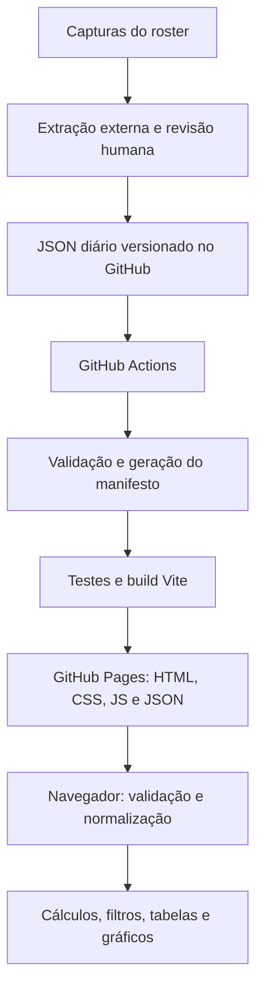

# DESO Alliance Dashboard — Documentação técnica

**Créditos do projeto: Anderson Tagata — ATTecnologies, 2026.**

Versão do projeto: 1.0.0 · Schema diário: 2 · Referência: implementação publicada em outubro de 2026.

- Repositório: <https://github.com/attagata/deso-dashboard>
- Aplicação: <https://attagata.github.io/deso-dashboard/>
- Guia de instalação e operação: [README](../README.md)
- Créditos e licença: [NOTICE](../NOTICE) e [Apache 2.0](../LICENSE)

## 1. Objetivo e escopo

Painel público, somente leitura, para acompanhar os membros da aliança DESO / Death Soldiers, servidor 2052, no jogo Last War: Survival. Oferece consultas por data, ranking, histórico individual de poder/HQ/rank, acompanhamento de atividade e diferenças de rank entre capturas.

A interface de produção é em inglês. Nomes de jogadores e metadados das fontes são preservados. Esta documentação é em português para facilitar a manutenção pelo administrador.

O site não modifica o jogo, não executa decisões administrativas e não processa screenshots. A extração das capturas e a revisão dos dados acontecem externamente, com ChatGPT e o administrador. Não há backend, banco de dados, autenticação, API externa, Docker ou serviço pago.

## 2. Arquitetura



GitHub Actions é usado apenas para construir, verificar e publicar arquivos estáticos. Todos os cálculos exibidos no dashboard são executados no navegador. O servidor local do Vite é uma ferramenta de desenvolvimento, não uma dependência da aplicação publicada.

### Tecnologias e decisões

| Área | Implementação | Motivo |
| --- | --- | --- |
| Interface | React 19 e TypeScript estrito | Componentes pequenos e contratos explícitos |
| Build | Vite 7 e TypeScript 5.9 | Build estático e verificação de tipos |
| Gráficos | Recharts 3 | Histórico de poder e distribuição de ranks |
| Estilo | CSS próprio e fontes do sistema | Layout responsivo sem framework visual ou fontes externas |
| Estado | Hooks locais do React | Volume pequeno, sem biblioteca global de estado |
| Dados | JSON diário, schema 2 | Histórico legível, revisável e versionado |
| Navegação | Fragmento da URL, `location.hash` | Perfis podem ser atualizados diretamente no GitHub Pages |
| Testes | `node:test` e `node:assert/strict` | Sem dependência adicional de testes |
| Runtime de ferramentas | Node.js 24 e npm | Execução dos testes e do validador TypeScript |
| Publicação | Actions oficiais do GitHub Pages | Sem infraestrutura adicional |

As versões exatas instaladas são fixadas em [package-lock.json](../package-lock.json). As faixas declaradas estão em [package.json](../package.json).

## 3. Organização do código

| Arquivo ou diretório | Responsabilidade |
| --- | --- |
| `src/main.tsx` | Montagem da aplicação em `StrictMode` e importação do CSS |
| `src/App.tsx` | Carregamento, estado global mínimo, hash routing, seleção de data, navegação e rodapé com créditos |
| `src/components/Dashboard.tsx` | Indicadores, top 10, movimentos de rank e diretrizes |
| `src/components/MemberTable.tsx` | Busca, filtros, ordenação, badges, variações e paginação de 25 registros |
| `src/components/MemberDetails.tsx` | Perfil, observações históricas e eventos de participação |
| `src/components/PowerChart.tsx` | Série histórica de poder com lacunas explícitas |
| `src/components/RankDistribution.tsx` | Distribuição de ranks com legenda numérica |
| `src/components/ActivityMonitor.tsx` | Categorias de atividade e lista para revisão administrativa |
| `src/components/Icons.tsx` | Ícones SVG locais |
| `src/services/dataService.ts` | Download dos JSONs locais e validação em runtime |
| `src/types/member.ts` | Tipos do schema diário e dos dados normalizados |
| `src/utils/statistics.ts` | Funções determinísticas de normalização, contagens e diferenças |
| `src/utils/validation.ts` | Regras compartilhadas de estrutura e linha do tempo |
| `src/styles.css` | Tema, responsividade, tabelas e acessibilidade visual |
| `scripts/validate-data.mjs` | Descoberta de arquivos, validação e geração do manifesto |
| `tests/statistics.test.ts` | Cálculos, dados ausentes, identidade, cronologia e preservação da fonte |
| `public/data/` | Fonte dos dados publicados |
| `source-data/` | Histórico original, preservado para auditoria |
| `.github/workflows/deploy.yml` | Pipeline de verificação e publicação |

## 4. Contrato dos dados

### 4.1 Arquivos diários

Cada captura diária é um arquivo `public/data/YYYY-MM-DD.json`. O campo `date` deve coincidir com o nome do arquivo. Há uma captura por data; não são aceitas duas observações do mesmo jogador no mesmo dia.

Estrutura mínima válida, intencionalmente sem jogadores fictícios:

```json
{
  "schema_version": 2,
  "date": "2026-10-21",
  "alliance": {
    "tag": "DeSo",
    "name": "Death Soldiers",
    "server": "2052"
  },
  "summary": {},
  "observations": [],
  "membership_events": []
}
```

A data acima é ilustrativa. Um arquivo vazio válido não equivale a uma captura completa e não deve ser publicado como substituto de dados ainda não extraídos.

### 4.2 Observações

| Campo | Tipo | Semântica |
| --- | --- | --- |
| `player_id` | string não vazia | Identidade interna estável entre arquivos |
| `name` | string não vazia | Nome observado naquela captura |
| `rank` | `R1` a `R5`, ou `null` | Rank efetivamente observado |
| `base_level` | inteiro positivo ou `null` | Nível do HQ |
| `power_m` | número não negativo ou `null` | Poder em milhões, na precisão da fonte |
| `visible` | boolean | Jogador observado ou explicitamente não observado |
| `last_seen` | `online`, valor com sufixo `m`/`h`/`d`, ou `null` | Indicador observado, preservado como texto |
| `last_seen_minutes` | número não negativo ou `null` | Conversão nominal do intervalo observado |
| `online_at_capture` | boolean ou `null` | Online no momento da captura, separado do intervalo |
| `source` | string não vazia | Origem da evidência |
| `identity_uncertain` | boolean opcional | Bloqueia conclusões de movimento de rank quando verdadeiro |
| `profile` | objeto opcional | Metadados adicionais do perfil daquela data |
| `membership_status` | string opcional | Campo legado preservado; não governa a classificação histórica |

As observações herdam a data do arquivo. Dados desconhecidos usam `null`, nunca zero como substituto. Zero de poder só deve representar uma observação real desse valor.

Quando `visible` é falso, `rank`, `base_level`, `power_m`, `last_seen`, `last_seen_minutes` e `online_at_capture` devem ser `null`. A omissão de uma linha também resulta em não observado para uma identidade já conhecida.

`online_at_capture: true` exige `last_seen: "online"` e `last_seen_minutes: null`. Um intervalo como `2h` corresponde nominalmente a 120 minutos; ele não representa duração da sessão, tempo diário de jogo ou precisão maior que a captura original.

### 4.3 Resumo oficial e eventos

`summary` pode armazenar `reported_members`, `reported_ranks` e `alliance_power` dos cabeçalhos do jogo, além de metadados originais. O poder oficial usa unidades completas; `power_m` de cada jogador usa milhões. Esses valores não são intercambiáveis.

`membership_events` aceita `departure` e `rejoin`. Cada evento exige `player_id`, `name`, `recorded_on`, `effective_date` e `source`; `previous_rank` é opcional. A data de registro deve coincidir com a captura. A data efetiva pode ser desconhecida (`null`), mas não pode ser posterior à confirmação.

Uma saída é registrada uma única vez e permanece no histórico. Para uma identidade confirmada como saída reaparecer como ativa, é necessário um evento explícito de retorno. A aplicação classifica participação pela data de confirmação, evitando atribuir uma data efetiva que a evidência não comprova.

### 4.4 Manifesto automático

`npm run validate:data` procura os arquivos diários, ordena seus nomes, valida os dados e grava `public/data/index.json` apenas quando não há erros:

```json
{
  "schema_version": 2,
  "last_updated": "2026-10-20",
  "files": [
    "2026-10-14.json",
    "2026-10-19.json",
    "2026-10-20.json"
  ]
}
```

O administrador não precisa editar o manifesto diariamente. O GitHub Pages não fornece listagem de diretórios para essa finalidade; o manifesto informa quais arquivos o navegador deve carregar.

## 5. Migração e rastreabilidade

O arquivo recebido, schema 1.1, foi preservado integralmente em [source-data](../source-data/DESO_member_history_2026-10-14_to_2026-10-20.json). Ele contém 103 identidades e capturas de 14, 19 e 20 de outubro de 2026.

A migração distribuiu cada `players[].snapshots[date]` no arquivo diário correspondente, mantendo os campos originais e acrescentando `player_id` e `name` à linha. Perfis datados foram associados à respectiva observação; metadados da aliança, resumo e política de dados foram preservados. Eventos aparecem na data em que foram registrados.

Estados globais sem data e descrições adicionais de saída continuam no original de auditoria. Eles não são aplicados retroativamente ao roster. O teste de preservação compara os três arquivos iniciais com a fonte recebida; alterações deliberadas dessas capturas exigem revisão dessa comparação, com justificativa no Git, sem modificar silenciosamente o original.

| Data | Visíveis | Soma individual | Saídas confirmadas até a data | Conhecidos não observados |
| --- | ---: | ---: | ---: | ---: |
| 2026-10-14 | 91 | 5.429.600.000 | 0 | 0 |
| 2026-10-19 | 97 | 5.615.800.000 | 4 | 0 |
| 2026-10-20 | 98 | 5.690.200.000 | 4 | 1 |

Em 19/10, o poder oficial registrado é 5.611.412.930. A diferença em relação à soma individual permanece explícita, sem ajuste artificial dos jogadores.

## 6. Carregamento e normalização

1. `App` inicia `loadData` com `AbortController` e cancela requisições ao desmontar.
2. `dataService` carrega o manifesto e verifica a lista de nomes permitidos.
3. Os arquivos diários são buscados em paralelo com `Promise.all`.
4. Cada resposta passa por parsing JSON, validação estrutural e comparação da data com o nome do arquivo.
5. A sequência completa passa pela validação cronológica.
6. `normalizeSnapshots` agrupa os jogadores pelo ID e associa observações e eventos em ordem de data.

As requisições usam `import.meta.env.BASE_URL`, `cache: 'no-store'` e um parâmetro de atualização baseado em `Date.now()`. Não há service worker ou persistência local autoritativa. Recarregar a página busca os dados novamente; o site não faz polling contínuo enquanto permanece aberto.

Mapeamento principal:

| Origem diária | Modelo em memória |
| --- | --- |
| `player_id` | `Member.id` |
| `date` do arquivo | `Observation.date` |
| `power_m` | `power = Math.round(power_m * 1_000_000)` |
| `base_level` | `level` |
| `last_seen` | `activityText` |
| `last_seen_minutes` | `inactivityMinutes` |
| `online_at_capture` | `online` |
| `identity_uncertain` | `identityUncertain`, falso se omitido |

A conversão numérica não aumenta a precisão da captura. O aplicativo mantém `null` quando não há valor.

## 7. Regras de cálculo

As funções estão em [statistics.ts](../src/utils/statistics.ts) e não dependem do relógio atual, armazenamento local ou serviços externos.

### Participação e data selecionada

`rowsForDate` considera apenas registros até a data selecionada. Identidades ainda não conhecidas naquela data não aparecem no roster histórico. A observação selecionada precisa corresponder exatamente à data; valores antigos não preenchem campos ausentes.

| Status | Regra |
| --- | --- |
| `departed` | Último evento confirmado até a data é uma saída |
| `active` | Sem saída vigente e com observação visível na data |
| `unobserved` | Identidade conhecida, sem saída vigente e sem observação visível naquela data |

`lastKnown` guarda a última observação visível até a data para contexto histórico. Não entra como substituto no poder ou na atividade daquele dia. O perfil apresenta também os últimos valores de todo o histórico, identificados como mais recentes; seu gráfico e tabela mostram todas as observações disponíveis.

### Poder, posição e variações

`summarize` soma os valores não nulos dos jogadores ativos observados na data e informa a cobertura dos registros. Um desconhecido não vira zero no registro, embora não contribua para a soma parcial. O total oficial é exibido separadamente.

O ranking usa poder decrescente, desempate pelo nome em locale inglês e depois pelo ID. Somente jogadores ativos com poder conhecido recebem posição. Ordenações e filtros da tabela não alteram os totais da aliança.

```text
Variação absoluta = poder observado atual − poder da observação visível anterior
Variação percentual = variação absoluta / poder anterior × 100
```

Se a observação anterior ou seu poder forem desconhecidos, a variação é desconhecida. A comparação não pula um poder nulo para buscar um número mais antigo. Percentuais só são calculados quando o poder anterior é positivo. Variações de magnitude igual ou superior a 10% recebem destaque visual, sem interpretação automática de desempenho.

### Novos observados e ranks

“Newly observed” conta jogadores ativos cuja primeira observação visível é naquela data. Na captura inicial, o indicador é indefinido, pois se trata da linha de base. O indicador não comprova a data de entrada na aliança.

A distribuição R1–R5 usa apenas ranks conhecidos de jogadores ativos na captura. `rankMovements` compara datas de captura adjacentes: exige duas observações visíveis, ranks conhecidos e diferentes, e identidade sem incerteza. Uma captura ausente impede a conclusão de mudança entre esses pontos. A data exata da decisão administrativa continua desconhecida.

### Atividade

| Categoria | Regra |
| --- | --- |
| Online | Online na captura, independentemente de minutos nulos |
| Recently Active | Menos de 1.440 minutos |
| Away | De 1.440 até menos de 7.200 minutos |
| Review Required | A partir de 7.200 minutos, equivalentes nominais a cinco dias |
| Unknown | Sem observação visível ou sem informação de atividade suficiente |

O tempo não é extrapolado a partir da data da captura. A lista de revisão utiliza jogadores ativos com evidência suficiente na data selecionada. Cinco dias de ausência indicam revisão por oficiais; não causam demissão, rebaixamento ou expulsão automáticos.

## 8. Interface, navegação e gráficos

As rotas são `#/` e `#/member/ID`, com `?date=YYYY-MM-DD` dentro do fragmento. O ID é codificado na URL. Como o fragmento não é enviado ao servidor, uma atualização direta abre o mesmo documento estático e preserva o perfil.

Data não disponível gera aviso explícito e seleciona a captura mais recente. ID inexistente exibe estado de jogador não encontrado. O aplicativo também diferencia carregamento, conjunto vazio e falha de dados.

O gráfico de poder usa pontos medidos e linha linear como guia visual, com `connectNulls={false}` e valores nulos nos dias sem observação. Não realiza interpolação de registros. Animações dos gráficos são desativadas. Os componentes gráficos são carregados com `React.lazy`/`Suspense`; o build separa Recharts em um chunk próprio.

O layout usa controles nativos, scroll horizontal em tabelas e paginação de 25 membros. Há rótulos acessíveis, navegação por teclado, foco visível e tabela de histórico como alternativa numérica ao gráfico. Testes em larguras de tela simuladas não substituem verificação em um iPhone físico.

## 9. Validação e testes

```sh
npm run validate:data
npm test
npm run build
```

`validateDailyData` verifica campos obrigatórios, schema, datas reais, ranks, tipos numéricos, valores negativos, atividade, visibilidade, fontes, identidades duplicadas e eventos. Nomes duplicados normalizados dentro de um dia são sinalizados para revisão de identidade. A normalização de nomes nessa verificação não altera o nome armazenado.

`validateTimeline` verifica ordem cronológica, datas duplicadas, identidade referenciada por eventos, saída repetida, retorno sem saída anterior e observação após saída sem retorno explícito. A ferramenta de linha de comando também verifica sintaxe JSON e nomes de arquivo. Em falha, retorna código diferente de zero e não regenera o manifesto. No navegador, dados inválidos geram mensagem de erro em vez de estatísticas parcialmente aceitas.

Os 11 testes existentes cobrem:

1. Diferenças de poder positivas, negativas, percentual e valores desconhecidos.
2. Contagens e distribuição de ranks das capturas reais.
3. Limites exatos das categorias de atividade.
4. Saídas por data de confirmação e preservação de não observados.
5. Poder e observações ausentes sem preenchimento automático.
6. Mudanças de rank com capturas adjacentes e identidade certa.
7. Mudanças de nome sem perda da identidade.
8. IDs, observações e datas duplicadas.
9. Campos, ranks, poder, unidades e datas inválidos.
10. Cronologia, retornos e datas efetivas inconsistentes.
11. Preservação das observações, perfis, metadados e eventos originais.

A versão inicial também foi verificada em navegador Chromium com busca, filtros, paginação, seleção de data, refresh do perfil, gráficos, estados vazio/erro e larguras de 320, 375, 390, 768 e 1440 pixels. Essas verificações de navegador foram executadas no ambiente de desenvolvimento e não integram o script `npm test`.

## 10. Build e publicação

Instalação reprodutível: `npm ci`. Desenvolvimento: `npm run dev`. Prévia local do build: `npm run preview`. O build executa validação, `tsc -b` e `vite build`, produzindo `dist/`.

O workflow é acionado por push em `main` ou `master`, pull requests e disparo manual. Nas pull requests executa verificações, sem publicar. Em push ou disparo manual:

1. Faz checkout e configura Node.js 24 com cache do npm.
2. Instala pelo lockfile com `npm ci`.
3. Valida dados e gera o manifesto.
4. Executa os testes.
5. Compila a aplicação usando o nome do repositório como base.
6. Envia `dist/` com `actions/upload-pages-artifact`.
7. Configura e publica com `actions/configure-pages` e `actions/deploy-pages`.

O job de build possui `contents: read`. O job de deploy utiliza `pages: write` e `id-token: write` para OIDC, sem credenciais no código. A concorrência cancela execuções anteriores da mesma referência. O repositório original utiliza `master` como branch padrão; ambas as branches são suportadas, mas alterações futuras devem ser sincronizadas ou concentradas na branch escolhida para evitar publicações divergentes.

Na ativação inicial: **Settings → Pages → Build and deployment → Source → GitHub Actions**. A integração de desenvolvimento pode enviar código sem ter acesso administrativo para ativar esse recurso; nesse caso o proprietário faz essa configuração uma vez.

`vite.config.ts` usa `/deso-dashboard/` por padrão. Em CI, `VITE_BASE_PATH` recebe `/${nome-do-repositório}/`. Se migrar para `USERNAME.github.io` na raiz, configurar `/`. Caminhos de dados e assets usam essa base, evitando dependência de caminhos absolutos incorretos.

## 11. Procedimento diário e recuperação

1. Registrar a data real das screenshots e revisar sua cobertura.
2. Extrair somente informações observadas e eventos confirmados.
3. Reutilizar IDs; revisar trocas de nome e possíveis duplicatas antes de confirmar identidade.
4. Adicionar `public/data/YYYY-MM-DD.json`, preservando arquivos anteriores.
5. Validar, testar e compilar, ou acompanhar essas etapas no GitHub Actions.
6. Fazer commit na branch de publicação e aguardar o deploy concluir.
7. Recarregar o site e conferir data, quantidade de observados e valores principais.

No iPhone, o JSON pode ser enviado por **Add file → Upload files** na pasta `public/data` do repositório. O build gera o manifesto; nenhum ajuste no código é necessário.

| Sintoma | Verificação e correção |
| --- | --- |
| Validador rejeita o arquivo | Ler arquivo/campo na mensagem, corrigir o JSON e executar novamente |
| Captura nova não aparece | Confirmar branch publicada, nome do arquivo, data e conclusão do workflow |
| Número de membros difere do cabeçalho | Verificar cobertura; comparar observados com número oficial, sem inventar linhas |
| Falha em Configure GitHub Pages | Conferir a opção GitHub Actions nas configurações do Pages |
| Assets ou dados retornam 404 | Conferir nome do repositório, base do Vite e manifesto publicado |
| Jogador desaparece de uma captura | Manter como não observado; só registrar saída com confirmação |
| Jogador retornou após saída | Registrar `rejoin` explícito antes de voltar a observá-lo como ativo |

Para desfazer uma atualização incorreta, preferir um novo commit que reverta a alteração, preservando a trilha do Git. Remover um dia inteiro altera a sequência de capturas e pode alterar quais datas são adjacentes no histórico de ranks; revisar esse efeito. Corrigir uma captura inicial exige considerar o teste de preservação contra o original de auditoria. Nunca incluir tokens ou credenciais em commits de recuperação.

## 12. Segurança, limites e manutenção

Os dados publicados são públicos por definição. O JSX renderiza nomes como texto; não há HTML arbitrário fornecido pelos JSONs. O loader restringe arquivos do manifesto ao padrão de data e utiliza apenas assets e dados estáticos do próprio site. Dependências de terceiros continuam sujeitas a suas próprias licenças e devem ser revisadas ao atualizar o lockfile.

Todos os JSONs são carregados em memória a cada abertura. O custo cresce com o número de capturas e jogadores. O volume atual é pequeno; para um histórico muito maior, considerar resumos estáticos gerados no build e carregamento sob demanda, mantendo o mesmo modelo sem backend.

Outros limites: uma captura por dia, poder na precisão exibida pelo jogo, identidade dependente de revisão humana, datas de entrada/saída nem sempre conhecidas, ausência de OCR e edição no site, e nenhuma medição de tempo diário de jogo. Capturas incompletas não permitem concluir ausência de participação.

Para manutenção: preservar os contratos TypeScript, atualizar dependências de forma revisada, executar testes e build, conferir a navegação em `/deso-dashboard/` e revisar o layout em dispositivos móveis após mudanças visuais.

## 13. Créditos e licença

**Anderson Tagata — ATTecnologies, 2026.**

O crédito está registrado nesta documentação, no README, no arquivo NOTICE e no rodapé público da aplicação. A licença Apache 2.0 já existente no repositório é mantida. Os créditos do projeto não transferem a titularidade de marcas, nomes ou assets de Last War: Survival nem das dependências utilizadas.
